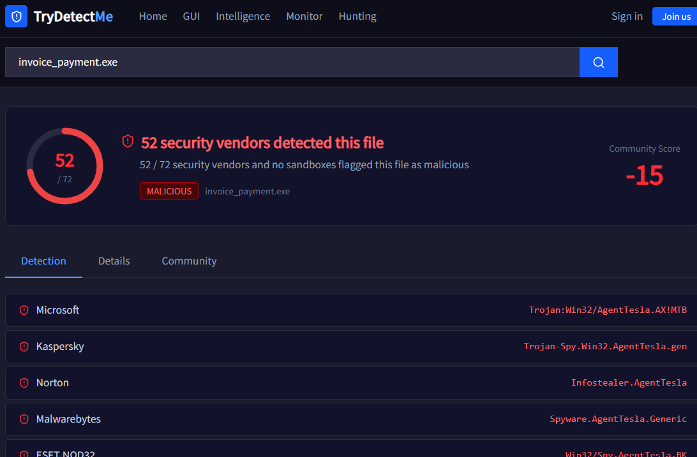

# Search Skills

**Path:** Cyber Security 101 › Start Your Cyber Security Journey
**Difficulty:** Easy
**Topic:** Knowing *where* to search for security information, not only *what* to search for

---

## Key Keywords

| Term | Meaning in one line |
|------|---------------------|
| **Shodan** | Search engine that scans the internet for *devices and services* (not websites' content) |
| **IoT** | Internet of Things: cameras, routers, smart devices, industrial systems connected to the internet |
| **Banner / HTTP header** | Text a service sends about itself (name, version). This is what Shodan reads |
| **ASN** | Autonomous System Number: an ID for a network owned by one organisation (e.g. AWS, Google) |
| **Filter** | A `name:value` keyword that narrows a search (`country:IE`, `port:22`) |
| **VirusTotal** | Checks a file, URL, domain or hash against 70+ antivirus engines at once |
| **Hash** | A fixed-length "fingerprint" of a file. Same file = same hash |
| **Blue team** | Defenders (detect, respond, protect) |
| **Red team** | Attackers (simulate real attacks to find weaknesses) |
| **CVE** | A unique ID for one publicly known vulnerability: `CVE-YEAR-NUMBER` |
| **CVSS** | A score (0–10) that tells you how *dangerous* a vulnerability is |
| **PoC** | Proof of Concept: code that proves a vulnerability is real |
| **ExploitDB** | Database collecting exploits and PoCs |
| **Man page** | Built-in Linux manual for a command (`man <command>`) |
| **README** | The file in a GitHub repo that explains what the project does and how to use it |

---

## Task 1: Introduction

Cyber security work is full of questions like *"what is this file?"*, *"is this version vulnerable?"*, *"how does this tool work?"*. Nobody memorises all the answers. A good analyst knows **which resource to open for which question**. This room is a map of those resources.

| Question you have | Where you look |
|-------------------|----------------|
| What is exposed on the internet? | Shodan |
| Is this file or link malicious? | VirusTotal |
| Is this software version vulnerable? | CVE databases / ExploitDB |
| How does this command or tool work? | Man pages / official docs |
| Is there exploit code or a technical write-up? | GitHub |

---

## Task 2: Shodan

### The idea in simple words
Google searches **web pages**. Shodan searches **machines and services**. It constantly scans the internet and records what is answering on each IP address: which port is open, which software is running, and which version.

### Why it matters
- **Offensive (pentest):** you find a server running an old version, then you check whether a known CVE affects that version.
- **Defensive:** a company can search for *its own* IP ranges to see what it is accidentally exposing (e.g. a forgotten database or camera).

### How it finds things
When you connect to a service, it often announces itself, for example `Server: Apache/2.4.1` in the HTTP headers. Shodan saves these announcements (called **banners**). So searching `apache 2.4.1` returns every server that announced that version.

### Filters

| Filter | What it does | Example |
|--------|--------------|---------|
| `country` | Only results from one country (2-letter code) | `country:IE` |
| `port` | Only a specific port | `port:22` |
| `org` | Only an organisation or ASN | `AS7224` (AWS) |
| `hostname` | Match a domain or hostname | `hostname:fakebank.thm` |

You can combine filters: `apache port:80 country:LB` means "Apache servers on port 80 in Lebanon".

### Common confusion
- **Shodan does not hack anything.** It only records what servers *voluntarily* say about themselves. Searching it is legal; attacking what you find is not.
- In the room, ASN is listed under `org`. In the real Shodan, ASN has its own filter: `asn:AS16509`.

### Getting the answer in the practical
Open the first result in the list. The details page shows the IP, the open ports and the associated domain/hostname.

---

## Task 3: VirusTotal

### The idea in simple words
Instead of installing 70 different antivirus programs, you upload the file (or paste a URL, domain or hash) once, and VirusTotal asks all of them for their opinion.

### How to read the result
- The number at the top is **how many engines flagged it** out of the total engines that checked it.
- Below it, a list shows **each vendor's verdict** and the malware name they gave it.


### Things to understand
- **Not foolproof.** A clean result does *not* mean safe. Brand-new malware may not be detected yet.
- **False positives exist.** One or two engines flagging a file is weak evidence. Many engines flagging it is strong evidence.
- **Hash first, upload second.** In real work you can search a file's *hash* instead of uploading the file. This matters because anything you upload may become visible to others, so never upload confidential company files.

### Who uses it
Blue teamers (SOC analysts) use it daily to triage suspicious attachments, links and IP addresses.

---

## Task 4: Vulnerability Databases (CVE)

### The idea in simple words
Imagine every vulnerability had a different nickname depending on the vendor. Chaos. **CVE** fixes this by giving each known vulnerability **one unique ID** that everyone uses.

### CVE vs CVSS (the part people mix up)

| | CVE | CVSS |
|---|-----|------|
| What is it? | The **name/ID** of a vulnerability | The **score** of how severe it is |
| Example | `CVE-2025-55182` | `9.8` |
| Answers | "*Which* vulnerability?" | "*How bad* is it?" |

### CVE format
`CVE - YEAR - NUMBER` → the year it was **assigned/published**, then a sequence number. Famous ones also get nicknames (Heartbleed, Log4Shell, React2Shell) because they are easier to remember.

### How CVSS is calculated
Based on factors like:
- **Impact:** what damage can it cause?
- **Complexity:** how hard is it to exploit?
- **Availability / exposure:** how likely is it that someone can actually exploit it?

### Severity ratings (CVSS v3.x)
The score is converted into a **severity label**. This label is what the question means by "classification". The room does not list the ranges:

| Score | Severity |
|-------|----------|
| 0.0 | None |
| 0.1 – 3.9 | Low |
| 4.0 – 6.9 | Medium |
| 7.0 – 8.9 | High |
| 9.0 – 10.0 | Critical |

### Why organisations care
They have hundreds of vulnerabilities and limited time, so they **patch the highest scores first**.

### ExploitDB
Collects exploits and **PoCs** for known vulnerabilities. Useful for attackers to test, and for defenders to understand what an attack looks like.

---

## Task 5: Technical Documentation (Man Pages)

### The idea in simple words
Every Linux command comes with a built-in manual. You don't need the internet to learn how `nc`, `nmap`, `ls`, etc. work.

```bash
man nc
```

### Reading a man page
| Section | What it tells you |
|---------|-------------------|
| **NAME** | What the command is, in one line |
| **SYNOPSIS** | The syntax. Shows all options and the order of arguments |
| **DESCRIPTION** | What each option does |
| **EXAMPLES** | Ready-to-use commands (usually at the bottom) |

### Tips for navigating (not covered in the room)
| Key | Action |
|-----|--------|
| `Space` / `↓` | Scroll down |
| `/word` then `Enter` | Search for a word (e.g. `/EXAMPLES`) |
| `n` | Jump to next match |
| `G` | Go to the bottom of the page |
| `q` | Quit |

### Reading the SYNOPSIS
Options are in `[ ]` brackets, meaning they are **optional**. In `nc [-46bCDdFhklNnrStUuvZz] [destination] [port]`, every letter is a flag you *may* use.

### Official documentation vs random tutorials
Official docs are written by the tool's developers and updated with each version. Tutorials can be outdated or wrong. **First stop, not last.**

---

## Task 6: GitHub

### The idea in simple words
Researchers often publish PoC code and technical analysis on GitHub **before** official sources publish anything. Searching a CVE ID on GitHub often leads to repos with PoCs, scanners or detailed explanations.

### What to look at in a repository
1. **README.md**: explains the vulnerability, affected versions and how to use the PoC.
2. **File list**: shows which scripts exist (names usually hint at their purpose).
3. **Commits / stars / author**: show how trustworthy and active the repo is.

### Warning: do not run code blindly
Not every PoC can be trusted:
- Some are **incomplete** or don't work.
- Some are **intentionally broken**.
- Some are **malware disguised as a PoC**, aimed at people who want to "test an exploit".

**Habit to build:** read the code, check the author, and test in an isolated VM before running anything.

### Getting the answer in the practical
Read the README. It usually describes what each file in the repo does, and the file list confirms the script names.

---

## Commands & Tools Used

| Command / Tool | What it does |
|----------------|--------------|
| `man <command>` | Opens the manual for a Linux command |
| `nc` (netcat) | Opens arbitrary TCP/UDP connections (reading its man page is the practice) |
| Shodan | Search engine for internet-connected devices |
| VirusTotal | Multi-engine malware/URL scanner |
| CVE database / ExploitDB | Find vulnerability details and exploit code |
| GitHub | Find PoCs and research |